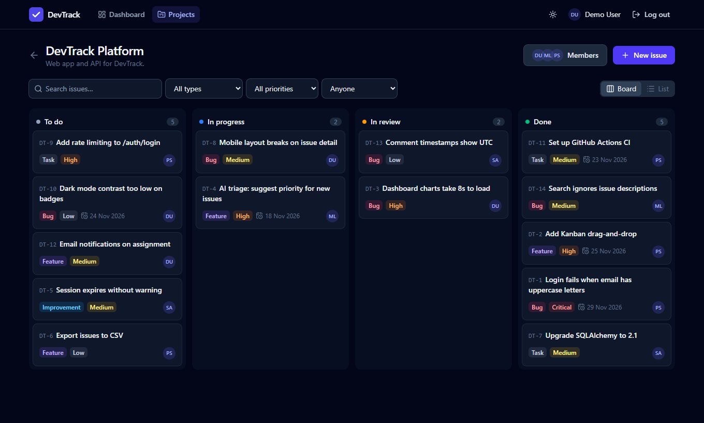
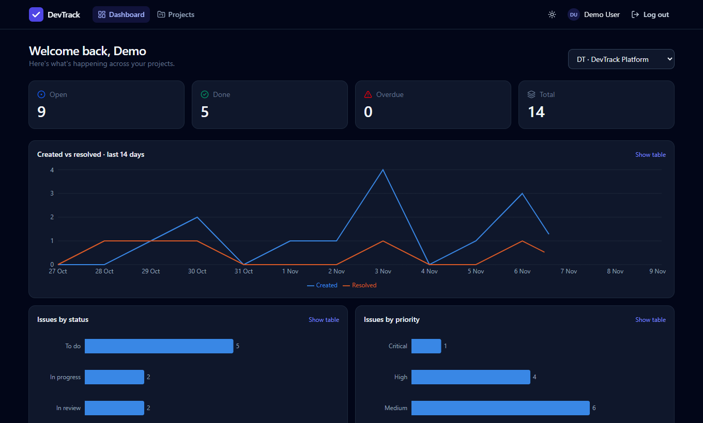
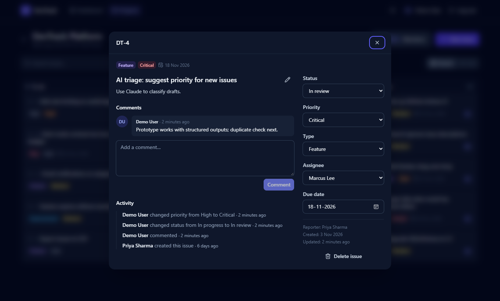
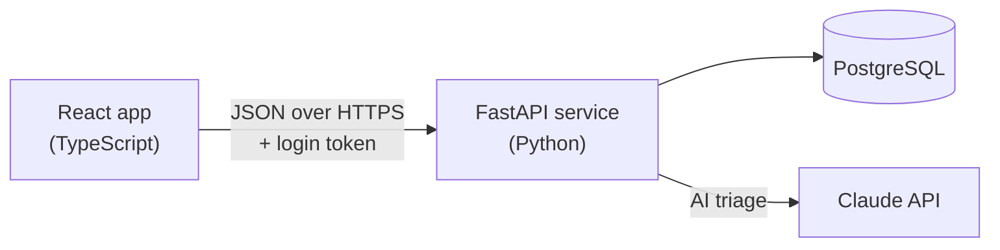

# DevTrack

**An issue tracker for software teams, like a small Jira, with AI that helps sort new bug reports.**




## What it does, in plain words

A team creates a **project**. Inside it, people write **issues**: bugs, features or tasks. Each issue gets a short key like `DT-12`, a priority, and an owner. Issues move across a **board** from *To do* to *Done*. Everyone can comment, and every change is recorded in a history.

When you write a new issue, **AI triage** (Claude) reads it and suggests a type, a priority, and a clearer title. It also warns you if the same problem was already reported.

A **dashboard** shows how the project is going: open issues, overdue issues, and how many were created and closed each day.

## Try it in 2 minutes

You need [Docker Desktop](https://www.docker.com/products/docker-desktop/).

```bash
git clone https://github.com/dineshkanna113/DevTrack.git
cd DevTrack
docker compose up --build
docker compose exec api python -m app.seed      # adds a demo team and issues
```

Open http://localhost:5173 and click **Try the demo account** (`demo@devtrack.dev` / `DemoPass123!`).
The API's interactive docs are at http://localhost:8000/docs.

To turn on AI triage, set `ANTHROPIC_API_KEY` before `docker compose up`. Without it, everything else works and the AI button stays hidden.

## Screenshots

| Dashboard | Issue detail and history |
|---|---|
|  |  |

## How it is built



| Part | Technology | Its job |
|---|---|---|
| Web app | React 19, TypeScript, Tailwind, TanStack Query | Screens, forms, drag-and-drop board, charts |
| API | FastAPI, Pydantic, SQLAlchemy 2.0 | Business rules, permissions, validation |
| Database | PostgreSQL, Alembic migrations | Stores users, projects, issues, comments, history |
| AI | Anthropic Claude, structured outputs | Suggests type, priority, title; finds duplicates |
| Quality | pytest (97% coverage), Vitest, Ruff, mypy, ESLint | Catches bugs before they ship |
| Delivery | Docker, GitHub Actions, Render, Vercel | Builds, tests and deploys on every push |

## Read more

| If you want to… | Read |
|---|---|
| Follow one issue through the whole system, file by file | [docs/WALKTHROUGH.md](docs/WALKTHROUGH.md) |
| See the diagrams: data model, request flow, security | [docs/ARCHITECTURE.md](docs/ARCHITECTURE.md) |
| Run it without Docker, run tests, add a feature | [docs/DEVELOPMENT.md](docs/DEVELOPMENT.md) |
| Deploy it (Render + Vercel) or fix a broken deploy | [docs/DEPLOYMENT.md](docs/DEPLOYMENT.md) |
| Explain the project in an interview | [docs/INTERVIEW_GUIDE.md](docs/INTERVIEW_GUIDE.md) |
| See what changed between versions | [CHANGELOG.md](CHANGELOG.md) |

## Features

- **Projects and teams:** invite members by email; owners manage the project, members work in it.
- **Issues:** keys like `DT-12`, four statuses, four priorities, four types, assignee, due date.
- **Board and list:** drag cards between columns, or search, filter, sort and page through a list. Filters live in the URL, so a filtered view is a shareable link.
- **Comments and history:** every change records who changed what, from which value to which value.
- **Dashboard:** open, done and overdue counts, a 14-day created-vs-resolved chart, status and priority breakdowns. Every chart also has a table view.
- **AI triage:** type, priority, cleaner title, one-line summary, likely duplicates.
- **Accounts and security:** passwords hashed with bcrypt, login tokens (JWT), role-based access, login rate limiting.
- **Dark mode**, works on phones, keyboard-accessible board and dialogs.

## Project layout

```
DevTrack/
├── devtrack-backend/     Python API (FastAPI). See devtrack-backend/README.md
├── devtrack-frontend/    React web app. See devtrack-frontend/README.md
├── docs/                 Walkthrough, architecture, development, deployment, interview guide
├── docker-compose.yml    Runs database + API + web app together
├── render.yaml           Deploys the API and database to Render
└── .github/workflows/    CI: lint, type-check, test, migrate, build
```

## License

Personal portfolio project by [Dinesh Kanna P](https://github.com/dineshkanna113).
