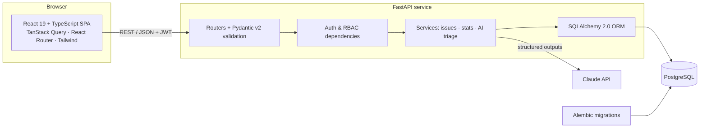

# DevTrack

**A full-stack issue tracker with Kanban boards, team projects, analytics, and AI-assisted triage.**


**Live demo:** [devtrack-frontend-sigma.vercel.app](https://devtrack-frontend-sigma.vercel.app) — click **Try the demo account**
**API docs:** `/docs` on the backend (OpenAPI / Swagger UI)

---

## Features

- **Projects & teams:** create projects, invite members by email, owner/member roles, Jira-style issue keys (`DT-42`)
- **Kanban board:** drag-and-drop between *To do → In progress → In review → Done* with optimistic updates and rollback on failure
- **List view:** full-text search, filters (type, priority, assignee), sorting, and pagination. Every view state lives in the URL, so filtered views and open issues are shareable links
- **Issue detail:** inline editing, comments, due dates, and a complete **activity log** (who changed what, from → to)
- **Analytics dashboard:** KPIs, created-vs-resolved trend, status and priority breakdowns, each chart with an accessible table view
- **AI triage (Claude):** paste a rough bug report and get a suggested type, priority, cleaned-up title, one-line summary, and **likely duplicates** from the project's open issues
- **Auth:** JWT (OAuth2 password flow), bcrypt hashing, role-based access control; non-members get 404s so resource ids don't leak
- **Dark mode**, responsive layout, keyboard-accessible dialogs and drag-and-drop

## Architecture



| Layer | Tech | Why |
| --- | --- | --- |
| Frontend | React 19, TypeScript (strict), Vite, Tailwind CSS v4 | Fast DX, type-safe UI |
| Data fetching | TanStack Query | Caching, background refetch, optimistic mutations |
| Forms | react-hook-form + Zod | Schema-validated forms with typed values |
| UI | dnd-kit, Recharts, Sonner, lucide-react | Accessible drag-and-drop, charts, toasts |
| Backend | FastAPI, Pydantic v2, SQLAlchemy 2.0 (typed), Alembic | Typed end-to-end, auto OpenAPI docs |
| Database | PostgreSQL 16 (SQLite for tests) | Relational integrity, cascading FKs, indexes |
| Auth | PyJWT, bcrypt, OAuth2 password flow | Standards-based, no unmaintained deps |
| AI | Anthropic Claude (structured outputs) | Schema-constrained JSON, no fragile parsing |
| Quality | pytest (97% coverage), Vitest + Testing Library, Ruff, mypy `--strict`, ESLint | |
| DevOps | Docker (multi-stage, non-root), docker-compose, GitHub Actions, Render blueprint, Vercel | |

## Quick start

### With Docker (recommended)

```bash
docker compose up --build
docker compose exec api python -m app.seed   # loads the demo workspace
```

- Web: http://localhost:5173 (log in as `demo@devtrack.dev` / `DemoPass123!`)
- API docs: http://localhost:8000/docs

To enable AI triage, export `ANTHROPIC_API_KEY` before `docker compose up`.

### Without Docker

```bash
# Backend (needs a Postgres database; see devtrack-backend/.env.example)
cd devtrack-backend
python -m venv .venv && source .venv/bin/activate   # Windows: .venv\Scripts\activate
pip install -r requirements-dev.txt
cp .env.example .env
alembic upgrade head && python -m app.seed
uvicorn app.main:app --reload

# Frontend
cd devtrack-frontend
npm install && cp .env.example .env
npm run dev
```

## Testing & quality gates

Every push runs the [CI pipeline](.github/workflows/ci.yml):

| Job | Checks |
| --- | --- |
| Backend | `ruff` lint + format, `mypy --strict`, `pytest` with a 90% coverage floor |
| Migrations | Against a real Postgres: `upgrade head` → `alembic check` (models ⇔ migrations drift) → `downgrade base` → `upgrade` → seed |
| Frontend | ESLint, `tsc` strict, Vitest + React Testing Library, production build |
| Docker | Builds both images |

```bash
cd devtrack-backend && pytest                # 38 tests, ~97% coverage
cd devtrack-frontend && npm test             # component + unit tests
```

## How the AI triage works

`POST /api/v1/projects/{id}/ai/triage` ([`services/ai_triage.py`](devtrack-backend/app/services/ai_triage.py))

1. Loads the project's 50 most recent open issues as duplicate candidates.
2. Sends the draft and candidates to Claude with a system prompt that defines each type and priority level. User text is wrapped in XML tags and treated as data, not instructions (prompt-injection hygiene).
3. Uses **structured outputs** (`messages.parse` with a Pydantic schema), so the response is always valid JSON with enum-constrained `type` and `priority`.
4. **Validates the model's output:** duplicate ids that aren't real candidates are dropped, so hallucinated ids never reach the UI.
5. Maps SDK errors to HTTP codes: rate limit → 429, auth/config → 503, refusal → 422, upstream → 502. The feature is fully optional: without an API key the endpoint returns 503 and the UI hides the button.

The Claude client sits behind a `Triager` protocol and is injected with FastAPI dependencies, so tests swap in a fake with no network calls.

## API overview

| Method | Path | Description |
| --- | --- | --- |
| `POST` | `/api/v1/auth/register` · `/login` | Create account / get JWT |
| `GET` | `/api/v1/auth/me` | Current user |
| `GET/POST` | `/api/v1/projects` | List / create projects |
| `GET/PATCH/DELETE` | `/api/v1/projects/{id}` | Project CRUD (owner-only writes) |
| `GET/POST/DELETE` | `/api/v1/projects/{id}/members[/{user_id}]` | Membership |
| `GET` | `/api/v1/projects/{id}/stats` | Dashboard aggregates |
| `GET/POST` | `/api/v1/projects/{id}/issues` | Filter · search · sort · paginate / create |
| `GET/PATCH/DELETE` | `/api/v1/issues/{id}` | Issue detail / partial update / delete |
| `GET/POST` | `/api/v1/issues/{id}/comments` | Comments |
| `GET` | `/api/v1/issues/{id}/activity` | Audit trail |
| `GET` | `/api/v1/issues/assigned-to-me` | Personal queue |
| `POST` | `/api/v1/projects/{id}/ai/triage` | AI triage suggestions |
| `GET` | `/health` | Liveness + DB check + feature flags |

## Project structure

```
.
├── devtrack-backend/          FastAPI service
│   ├── app/{core,db,api,services}
│   ├── alembic/               migrations (incl. v1 → v2 data migration)
│   └── tests/
├── devtrack-frontend/         React + TypeScript SPA
│   └── src/{auth,components,hooks,lib,pages,test}
├── docker-compose.yml         local full stack
├── render.yaml                API + Postgres infrastructure-as-code
└── .github/workflows/ci.yml
```

## Engineering notes

- **Zero-data-loss migration from v1.** v1 used `create_all()` with no history. Migration `0002` moves every user's issues into a personal project, maps legacy statuses and labels, resolves `assigned_to` emails to user FKs, and normalizes email case. It's reversible and tested in CI.
- **Race-free issue numbering.** Per-project keys come from an atomic `UPDATE … RETURNING` on a counter, plus a unique `(project_id, number)` constraint as a backstop.
- **Optimistic UI.** Kanban moves update every cached page immediately, roll back on error, and re-sync on settle.
- **Security.** bcrypt with 72-byte input bounds, tokens carry a `type` claim, production refuses to start with the default secret, CORS is env-driven, and the container runs as non-root.

## Roadmap

- Refresh tokens and login rate limiting
- Real-time board updates over WebSockets
- Email/Slack notifications on assignment
- Playwright end-to-end tests
