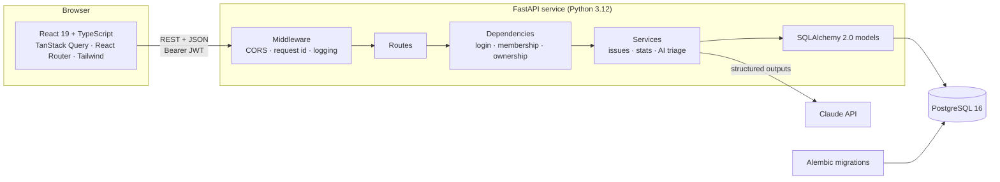
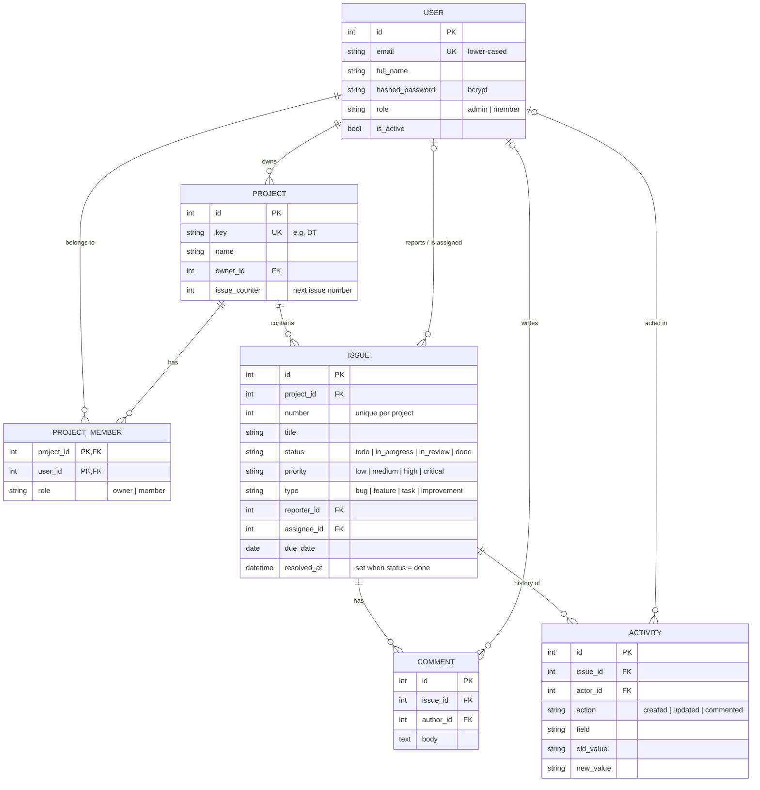
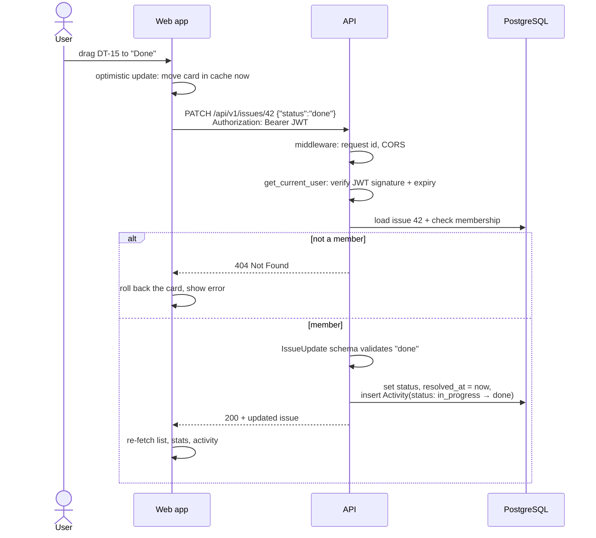
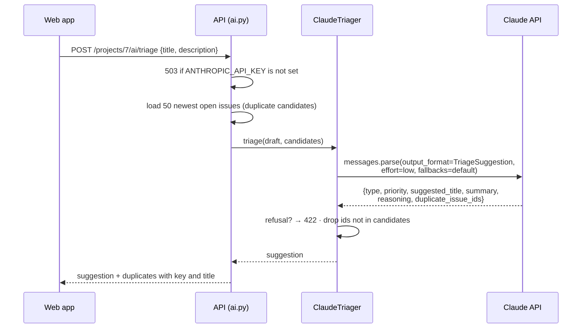

# Architecture

How DevTrack is put together, shown with diagrams. For a step-by-step story through the code, read the [walkthrough](WALKTHROUGH.md) first.

## 1. The system



Hosting: the web app is a static build on **Vercel**. The API runs as a Docker container on **Render**, with Render-managed PostgreSQL. `docker-compose.yml` runs the same three pieces locally.

## 2. Backend layers

Each request passes through the layers in order. Each layer only talks to the one below it.

| Layer | Files | Responsibility | Never does |
|---|---|---|---|
| Routes | `app/api/routes/*.py` | Map HTTP to function calls; pick status codes | Business rules, SQL |
| Dependencies | `app/api/deps.py` | Load the current user; enforce membership and ownership | Change data |
| Schemas | `app/schemas.py` | Validate input; shape output (Pydantic v2) | Touch the database |
| Services | `app/services/*.py` | Business rules: numbering, history, stats, AI | Know about HTTP |
| Models | `app/models.py` | Tables and relations (SQLAlchemy 2.0, typed) | Contain rules |
| Core | `app/core/*.py` | Settings, password hashing, JWT, logging, rate limiting | — |

Why this split: services can be unit-tested without HTTP, permission checks live in one place and can't be forgotten in a route, and swapping something (say, the AI provider) touches one file.

## 3. Data model



Design notes:

- **Issue keys** (`DT-12`) are the project key plus a per-project number. The number comes from an atomic `UPDATE … RETURNING` on `projects.issue_counter`, and a unique constraint on `(project_id, number)` catches anything that slips through.
- **Enums are stored as text** (`VARCHAR`), not database enum types. Adding a status later is a code change, not a risky `ALTER TYPE`.
- **Deleting** a project cascades to its issues, comments and activity. Deleting a user keeps the issues they reported or were assigned and their comments, with that person set to empty (`ON DELETE SET NULL`), so history survives. Projects the user *owns* are deleted with them (`projects.owner_id` is `ON DELETE CASCADE`). There is no ownership-transfer endpoint yet; it's listed in the [roadmap](INTERVIEW_GUIDE.md#what-id-do-next).
- **Constraint names** follow a fixed naming convention (`app/db/base.py`), so migrations behave the same on PostgreSQL and SQLite.

## 4. One request, end to end

Moving an issue to *Done* on the board:



## 5. Who can do what

| Action | Member | Project owner | Admin | Not a member |
|---|:-:|:-:|:-:|:-:|
| See the project, issues, comments, history, stats | ✓ | ✓ | ✓ | 404 |
| Create, edit, move issues; comment | ✓ | ✓ | ✓ | 404 |
| Delete an issue | own reports | ✓ | ✓ | 404 |
| Delete a comment | own | own | ✓ | — |
| Rename or delete the project; add or remove members | — | ✓ | ✓ | 404 |
| Remove the project owner | — | — | — | — |

Non-members get **404, not 403**, so they can't discover which project or issue ids exist. The checks live in `app/api/deps.py` (`get_project_for_member`, `require_project_owner`, `get_issue_for_member`), and every route that needs them declares them as a dependency.

## 6. Security

| Threat | Defence | Where |
|---|---|---|
| Stolen database | Passwords stored as bcrypt hashes; inputs capped at bcrypt's 72-byte limit | `core/security.py`, `schemas.py` |
| Forged login tokens | JWTs signed with `SECRET_KEY`; `exp`, `sub` and a `type` claim are required. Production refuses to start with the default secret | `core/security.py`, `core/config.py` |
| Password guessing | Login rate limiter: 5 failures per account per address, 20 per address, in 15 minutes, then `429` with `Retry-After` | `core/rate_limit.py` |
| Finding registered emails | Same bcrypt work for unknown emails (dummy hash) and the same error text | `api/routes/auth.py` |
| Seeing other teams' data | Membership checked in dependencies; non-members get 404 | `api/deps.py` |
| SQL injection | All queries built with SQLAlchemy, never string-formatted | everywhere |
| Prompt injection via bug text | Bug text wrapped in tags and treated as data; output forced into a schema; unknown ids dropped | `services/ai_triage.py` |
| Cross-site requests | CORS allows only configured origins (`CORS_ORIGINS`) | `main.py` |
| Container escape impact | Docker image runs as a non-root user | `Dockerfile` |

Known limits, on purpose for a portfolio-sized app:

- Tokens live in `localStorage`. That's simple, but an XSS bug could read them. The stronger option is an `httpOnly` cookie plus CSRF protection.
- The rate limiter keeps counts in memory, which is correct for one API process. With several replicas, move the counters to Redis.
- There are no refresh tokens. Sessions simply last 24 hours.

## 7. AI triage



Choices worth knowing:

- **Structured outputs** guarantee valid JSON with allowed values only, so there's no fragile text parsing.
- **Low effort**: sorting a bug report doesn't need deep reasoning, and low effort keeps it fast and cheap.
- **Fallbacks**: if a safety classifier declines, the API retries on a recommended model automatically.
- **Dependency injection**: routes get a `Triager` from `get_triager()`. Tests override it with a fake, so the suite never calls the network.

## 8. Frontend structure

```
src/
├── main.tsx, App.tsx      Routes; dashboard loaded lazily (charts are the heaviest code)
├── auth/                  Login state (AuthContext) and the guard for private pages
├── lib/
│   ├── api.ts             Every HTTP call in one typed object; token interceptors; error messages
│   ├── types.ts           TypeScript copies of the API's response shapes
│   ├── constants.ts       Labels and colours for statuses, priorities, types
│   └── format.ts          Dates and "3 days ago"
├── hooks/queries.ts       TanStack Query hooks: caching, invalidation, optimistic updates
├── components/            UI kit (ui.tsx), layout, issue board, issue dialogs
└── pages/                 One file per screen
```

Rules the frontend follows:

1. **Server data lives in TanStack Query, not in component state.** After a change, the related queries are invalidated and re-fetched, so screens never drift from the database.
2. **All HTTP goes through `lib/api.ts`.** One place for the base URL, the token and error handling.
3. **View state lives in the URL** (filters, board/list, open issue), so any view can be bookmarked or shared.
4. **Accessible by default**: native `<dialog>` for modals, labelled form fields, keyboard drag-and-drop, and a table view for every chart.
