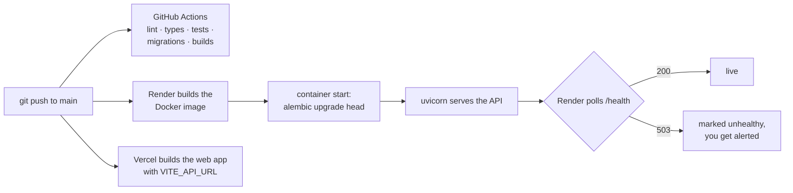

# Deployment

DevTrack deploys as two pieces:

| Piece | Host | Built from | Config |
|---|---|---|---|
| API + PostgreSQL | [Render](https://render.com) | `devtrack-backend/Dockerfile` | `render.yaml` |
| Web app | [Vercel](https://vercel.com) | `devtrack-frontend/` (`npm run build`) | `devtrack-frontend/vercel.json` |

## Current status (checked 2026-11-09)

The live demo is **not working**. Two separate problems:

| Check | Result | Meaning |
|---|---|---|
| `GET https://devtrack-backend-758s.onrender.com/` | 200, v2 API | The API code is deployed |
| `GET …/health` | `"database": "unavailable"` | The API can't reach its database |
| Web app bundle on Vercel | calls `http://localhost:8000` | It was built without `VITE_API_URL` |

The likely cause of the database error is that the free Render PostgreSQL from v1 has expired. Free Render databases are deleted after a limited period. Since this release, both problems are caught automatically: `/health` returns **503** when the database is down, and a production web build **fails** if `VITE_API_URL` is missing.

## Fix the live demo

### 1. Give the API a database (Render)

1. In Render, create a **PostgreSQL** database (or deploy `render.yaml` as a Blueprint, which creates the database and the API together).
2. Open the API service, go to **Environment**, and set:

   | Key | Value |
   |---|---|
   | `DATABASE_URL` | the database's **Internal Database URL** |
   | `SECRET_KEY` | a long random string: `python -c "import secrets; print(secrets.token_urlsafe(48))"` |
   | `ENVIRONMENT` | `production` |
   | `CORS_ORIGINS` | `https://devtrack-frontend-sigma.vercel.app` |
   | `ANTHROPIC_API_KEY` | optional; turns on AI triage |

3. Redeploy. The container runs `alembic upgrade head` on start, so the tables are created automatically.
4. Add the demo data once. In Render, open the service **Shell** and run `python -m app.seed`.
5. Check `https://devtrack-backend-758s.onrender.com/health`. It should return **200** with `"database": "ok"`.

> Reusing an old v1 database instead? It has tables but no migration history. In the Shell, run `alembic stamp 0001` once, then `alembic upgrade head`. Migration `0002` moves the v1 data into the v2 tables without losing anything.

### 2. Point the web app at the API (Vercel)

1. Vercel → project → **Settings** → **Environment Variables**. Add `VITE_API_URL` = `https://devtrack-backend-758s.onrender.com` for **Production** (no trailing slash).
2. Check **Settings** → **General** → **Root Directory** is `devtrack-frontend`.
3. **Deployments** → latest → **Redeploy**. Vite bakes the variable into the build, so a redeploy is required.
4. Open the site, press F12, open the **Network** tab, and sign in. Requests should go to `onrender.com`, not `localhost`.

### 3. Security clean-up

The v1 repository once committed a `.env` file with that database's password. If that old database still exists anywhere, **rotate its password or delete it**. The file is gone from the current code, but it's still visible in the Git history.

## How a deploy works

- `render.yaml` sets `healthCheckPath: /health`. Render keeps the previous version running if a new one never reports healthy.
- Migrations run before the server starts. If a migration fails, the new container never serves traffic.
- Free Render services sleep when idle. The first request after a pause can take up to about a minute.

## Running it elsewhere

Any host that runs Docker works. You need three things:

1. A PostgreSQL database and its URL.
2. The API image from `devtrack-backend/Dockerfile`, with the variables above. It listens on `$PORT` (default 8000) and runs as a non-root user.
3. A static host for `devtrack-frontend/dist`, built with `VITE_API_URL` set. Unknown paths must serve `index.html`, because the app uses client-side routing. `nginx.conf` and `vercel.json` already do this.
